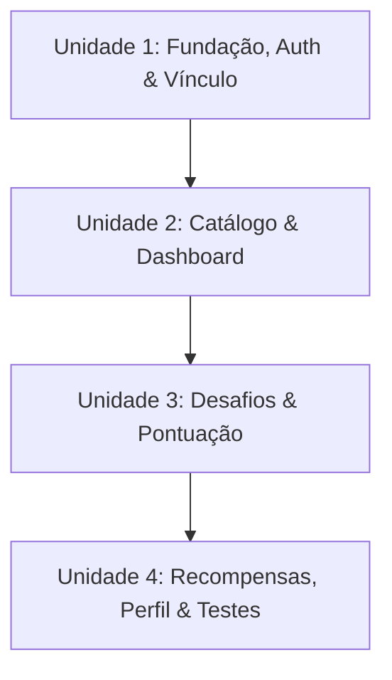

# Especificação Técnica — Romantic (docs/SPEC.md)

> **Versão:** 1.0.0  
> **Status:** Aprovado  
> **Metodologia:** Spec-Driven Development (SDD)  
> **Fonte da Verdade:** Este documento é a especificação canônica do projeto Romantic. Nenhuma funcionalidade ou alteração arquitetural deve ser implementada fora do que está estabelecido aqui.

---

## 1. Problema e Visão do Produto

### 1.1 Contexto e Problema
Após o início de um relacionamento ("depois do match"), muitos casais caem na rotina e enfrentam dificuldade em planejar momentos de qualidade e manter o romance vivo no dia a dia. A correria diária, o cansaço e a indecisão ("o que vamos fazer hoje?") desgastam a conexão emocional e a cumplicidade.

### 1.2 Proposta de Valor
O **Romantic** é uma aplicação web mobile-first voltada para casais (com foco inicial na faixa etária de 18 a 25 anos) que gamifica a rotina a dois. O casal escolhe ideias de atividades criativas e viáveis, transforma-as em desafios concretos, conclui com o registro de memórias afetivas (foto e/ou mensagem), acumula pontos e ofensiva (dias seguidos de atividade) e resgata recompensas personalizadas criadas pelos próprios parceiros.

* **Slogan:** *"Para continuar escolhendo depois do match."*
* **Alinhamento com Objetivos de Desenvolvimento Sustentável (ODS da ONU):**
  * **ODS 3 — Saúde e Bem-Estar (Principal):** Fortalecimento dos laços afetivos, redução do estresse diário, saúde mental e qualidade de vida por meio de momentos de lazer e conexão mútua.
  * **ODS 5 — Igualdade de Gênero:** Parceria equilibrada, comunicação aberta e divisão colaborativa do planejamento das atividades do casal, sem sobrecarga emocional para nenhuma das partes.

---

## 2. Escopo do MVP

### 2.1 No Escopo (MVP)
1. **Autenticação e Sessão Local:** Cadastro com validação e senha com hash SHA-256; login/logout; persistência de sessão.
2. **Vínculo do Casal:** Envio de convite via e-mail do parceiro, listagem de convites recebidos, aceite e recusa; vínculo estrito 1-para-1.
3. **Catálogo de Ideias e Ideia do Dia:** 20 ideias estáticas pré-cadastradas categorizadas; algoritmo determinístico de Ideia do Dia baseado na data calendário.
4. **Desafios e Memórias:** Aceite de ideia como desafio ativo do casal; conclusão de desafio com memória opcional (mensagem de texto e foto em base64 ≤ 300 KB).
5. **Pontuação e Ofensiva (Streak):** Saldo de pontos do casal, total acumulado, cálculo de dias consecutivos de atividade e registro da última conclusão.
6. **Recompensas Customizadas:** Criação de recompensas com custo em pontos pelo casal; listagem de recompensas disponíveis e histórico de resgates; resgate com débito de pontos.
7. **Perfil do Casal:** Exibição dos dados dos parceiros, tempo de vínculo, estatísticas de desafios concluídos e galeria de memórias registradas.

### 2.2 Fora do Escopo (Pós-MVP / Não Implementar)
* Avaliação/feedback pós-atividade (estrelas ou resenhas complexas).
* Desafios secretos ou surpresas.
* Trilhas temáticas guiadas.
* Calendário integrado interativo.
* Ranking global ou social entre diferentes casais.
* Personalização avançada de temas/cores por usuário.
* Desafio criado manualmente pelo parceiro (apenas ideias do catálogo viram desafios no MVP).
* Notificações push ou integração com WebSockets/Back-end remoto.

---

## 3. Requisitos Funcionais (RF)

| ID | Título | Descrição |
| :--- | :--- | :--- |
| **RF01** | Cadastro e Login | Permitir cadastro de usuário (nome, e-mail único, senha com mínimo de 6 caracteres e data de nascimento), autenticação via e-mail/senha com hash SHA-256, logout e manutenção da sessão ativa. |
| **RF02** | Gestão de Vínculo do Casal | Permitir que um usuário envie convite para o e-mail do parceiro, visualize convites recebidos, aceite ou recuse o convite. O casal só é formado após o aceite mútuo. |
| **RF03** | Ideia do Dia e Sugestões | Apresentar no Dashboard uma "Ideia do Dia" selecionada de forma determinística pela data atual, além de sugestões rápidas de atividades. |
| **RF04** | Explorar e Filtrar Ideias | Listar catálogo de ideias com filtros por categoria (Em casa, Ao ar livre, Românticas, Divertidas, Rápidas, Baixo custo) e busca textual por título/descrição; visualização da tela de detalhes da ideia. |
| **RF05** | Aceitar e Concluir Desafios | Permitir ao casal aceitar uma ideia do catálogo como desafio ativo; concluir o desafio registrando opcionalmente uma memória (mensagem e/ou foto comprimida em base64 ≤ 300 KB). |
| **RF06** | Pontuação e Ofensiva | Calcular e exibir os pontos totais acumulados, saldo disponível (pontos ganhos menos pontos gastos em resgates), ofensiva diária (dias seguidos) e data da última conclusão. |
| **RF07** | Recompensas do Casal | Permitir cadastrar recompensas personalizadas (título, descrição, custo em pontos), listar recompensas disponíveis e resgatadas, e efetuar o resgate mediante saldo suficiente. |

---

## 4. Requisitos Não Funcionais (RNF)

| ID | Requisito | Métrica / Critério de Aceite |
| :--- | :--- | :--- |
| **RNF01** | Responsividade Mobile-First | Layout fluido e sem rolagem horizontal nas resoluções 360px (mobile), 768px (tablet) e 1200px (desktop). |
| **RNF02** | Compatibilidade de Navegadores | Execução integral e sem erros nos navegadores Google Chrome, Microsoft Edge e Mozilla Firefox em versões recentes. |
| **RNF03** | Desempenho de Carga | Tempo total de carregamento inicial inferior a 3 segundos em conexão de rede 3G rápida simulada (Fast 3G). |
| **RNF04** | Segurança de Credenciais | Senhas nunca armazenadas em texto puro; hashing criptográfico SHA-256 obrigatório via Web Cryptography API (`crypto.subtle`). |
| **RNF05** | Separação de Camadas (Testabilidade) | Regras de negócio puras isoladas da manipulação de DOM, distribuídas em módulos testáveis via runner automatizado em navegador (`tests/tests.html`). |
| **RNF06** | Acessibilidade (WCAG 2.1 AA) | Score de acessibilidade no Google Lighthouse ≥ 90; tags semânticas, `lang="pt-BR"`, rótulos em todos os inputs, texto alternativo em imagens, foco visível, contraste mínimo 4,5:1. |

---

## 5. Regras de Negócio (RN)

* **RN01 (Acesso Restrito):** Só usuário autenticado pode acessar as páginas de dashboard, perfil do casal, desafios, ideias, explorar, ideia detalhe, recompensas e vínculo. Usuários anônimos que tentarem acessar rotas protegidas devem ser redirecionados imediatamente para `login.html`.
* **RN02 (Exclusividade do Casal):** Um usuário pode pertencer a no máximo 1 (um) casal ativo. O vínculo só é ativado e persistido no momento em que o parceiro convidado aceita formalmente o convite pendente.
* **RN03 (Isolamento de Dados do Casal):** Apenas os integrantes daquele casal específico podem visualizar, criar, aceitar e concluir desafios do respectivo casal, bem como gerenciar suas recompensas e visualizar memórias.
* **RN04 (Unicidade de Conclusão):** Um desafio só pode ser concluído uma única vez e só concede seus respectivos pontos uma única vez. Tentativas de concluir um desafio já finalizado são rejeitadas.
* **RN05 (Regra da Ofensiva e Pontuação):** Pontos e ofensiva (dias consecutivos) só são computados após a conclusão válida de um desafio.
  * Se a conclusão ocorrer no dia calendário imediatamente subsequente ao da última conclusão (+1 dia), a ofensiva é incrementada em +1.
  * Se o intervalo for superior a 1 dia (mais de 1 dia sem concluir), a ofensiva é reiniciada com o valor 1.
  * Múltiplas conclusões ocorridas no mesmo dia calendário concedem os pontos de cada desafio, mas **não** incrementam a ofensiva adicionalmente além da primeira do dia.
  * Na primeira conclusão de toda a história do casal, a ofensiva é fixada em 1.
* **RN06 (Regra de Resgate de Recompensas):** Uma recompensa só pode ser resgatada se o saldo de pontos do casal for maior ou igual ao custo da recompensa. O resgate debita imediatamente o custo do saldo.
  $$\text{Saldo} = \sum (\text{Pontos das Atividades Concluídas}) - \sum (\text{Custo das Recompensas Resgatadas})$$
* **RN07 (Validação de Cadastro):** O e-mail deve ter formato sintático válido e ser estritamente único entre todos os usuários cadastrados. A senha deve possuir tamanho mínimo obrigatório de 6 caracteres.
* **RN08 (Validação de Convites):** Não é permitido enviar convite de casal para si mesmo (próprio e-mail) nem convidar usuários que já pertençam a outro casal ativo.

---

## 6. Modelo de Dados

Toda a persistência do sistema ocorre no navegador via `localStorage`, utilizando a chave única `"romantic:v1"`.

### 6.1 Estrutura do Objeto Raiz (`romantic:v1`)

```typescript
interface RomanticStorageV1 {
  usuarios: Usuario[];
  sessao: Sessao | null;
  convites: Convite[];
  casais: Casal[];
  desafios: Desafio[];
  recompensas: Recompensa[];
}

interface Usuario {
  id: string;             // UUID gerado
  nome: string;           // Nome de exibição
  email: string;          // E-mail minúsculo, único
  senhaHash: string;      // Hash SHA-256 em hexadecimal
  dataNascimento: string; // Formato YYYY-MM-DD
  casalId: string | null; // ID do casal vinculado ou null
  criadoEm: string;       // ISO 8601 UTC
}

interface Sessao {
  usuarioId: string;      // ID do usuário autenticado no navegador
}

interface Convite {
  id: string;             // UUID
  deUsuarioId: string;    // ID do remetente
  paraEmail: string;      // E-mail do parceiro convidado (normalizado)
  status: "PENDENTE" | "ACEITO" | "RECUSADO";
  criadoEm: string;       // ISO 8601 UTC
}

interface Casal {
  id: string;             // UUID
  usuarioIds: [string, string]; // Array com os IDs dos dois parceiros
  apelido: string;        // Nome carinhoso do casal (ex: "Amor & Vida")
  criadoEm: string;       // ISO 8601 UTC
}

interface Memoria {
  foto: string | null;    // Data URI em base64 (≤ 300 KB) ou null
  mensagem: string | null;// Texto carinhoso ou reflexão
}

interface Desafio {
  id: string;             // UUID
  casalId: string;        // ID do casal dono do desafio
  ideiaId: string;        // ID de referência em dados-ideias.js
  titulo: string;         // Título da ideia
  pontos: number;         // Pontos a serem concedidos
  status: "ACEITO" | "CONCLUIDO";
  criadoPorId: string;    // ID do parceiro que aceitou
  criadoEm: string;       // ISO 8601 UTC
  concluidoEm: string | null;     // ISO 8601 UTC ou null
  concluidoPorId: string | null;  // ID do parceiro que concluiu ou null
  memoria: Memoria | null;        // Registro da memória ou null
}

interface Recompensa {
  id: string;             // UUID
  casalId: string;        // ID do casal
  titulo: string;         // Ex: "Massagem nos pés por 20 min"
  descricao: string;      // Detalhes da recompensa
  custo: number;          // Valor em pontos (> 0)
  status: "DISPONIVEL" | "RESGATADA";
  criadoEm: string;       // ISO 8601 UTC
  resgatadaEm: string | null;     // ISO 8601 UTC ou null
}
```

### 6.2 Estrutura Estática das Ideias (`js/dados-ideias.js`)
As ideias **não** são gravadas no `localStorage`. Elas compõem uma coleção imutável em memória com 20 itens:

```typescript
interface Ideia {
  id: string;             // Ex: "ideia-01"
  titulo: string;
  descricao: string;
  categoria: "Em casa" | "Ao ar livre" | "Românticas" | "Divertidas" | "Rápidas" | "Baixo custo";
  tempoMin: number;       // Duração estimada em minutos
  custo: "Grátis" | "Baixo" | "Médio";
  dificuldade: "Fácil" | "Médio" | "Difícil";
  pontos: number;         // Ex: 50, 100, 150
  icone: string;          // Classe de ícone Bootstrap Icons (ex: "bi-heart-fill")
}
```

---

## 7. Contrato de Módulos e Assinaturas

Todos os módulos expõem objetos globais nos scripts (`window.<Modulo>`).
Erros de regras de negócio devem obrigatoriamente instanciar e lançar `new RegraViolada(regra, mensagem)`.

### 7.1 Classe de Erro (`js/storage.js`)
```javascript
class RegraViolada extends Error {
  constructor(regra, mensagem) {
    super(`[${regra}] ${mensagem}`);
    this.name = "RegraViolada";
    this.regra = regra;     // Código da regra (ex: "RN06")
    this.mensagem = mensagem; // Descrição legível
  }
}
```

### 7.2 Módulo `Store` (`js/storage.js`)
* `Store.ler(): RomanticStorageV1` — Lê e retorna o estado atual. Se o storage estiver vazio ou corrompido, inicializa e salva a estrutura padrão.
* `Store.salvar(estado: RomanticStorageV1): void` — Serializa e grava o estado completo na chave `"romantic:v1"`.
* `Store.resetar(): RomanticStorageV1` — Limpa a chave `"romantic:v1"`, recria o estado inicial vazio e o persiste.
* `Store.novoId(): string` — Gera e retorna um identificador único alfanumérico (UUID v4).

### 7.3 Módulo `Auth` (`js/auth.js`)
* `async Auth.cadastrar({ nome, email, senha, dataNascimento }): Promise<Usuario>` — Valida RN07, gera hash SHA-256 da senha, persiste usuário e estabelece sessão ativa.
* `async Auth.login(email, senha): Promise<Usuario>` — Valida credenciais (comparando hash SHA-256), estabelece sessão e retorna o usuário. Lança erro caso incorretos.
* `Auth.logout(): void` — Remove a sessão ativa (`sessao = null`).
* `Auth.usuarioAtual(): Usuario | null` — Retorna os dados do usuário autenticado ou `null` se anônimo.
* `Auth.exigirLogin(caminhoLogin = "login.html"): Usuario` — Implementa RN01: se não houver usuário logado, redireciona o navegador para o login relativo e interrompe o fluxo.

### 7.4 Módulo `Casal` (`js/casal.js`)
* `Casal.convidar(emailParceiro: string): Convite` — Valida RN01, RN02 e RN08. Cria e persiste convite com status `"PENDENTE"`.
* `Casal.convitesRecebidos(): Convite[]` — Retorna os convites pendentes enviados para o e-mail do usuário autenticado.
* `Casal.aceitarConvite(conviteId: string): Casal` — Valida RN02 e RN08. Atualiza o status do convite para `"ACEITO"`, cria o registro do `Casal`, atualiza `casalId` de ambos os parceiros.
* `Casal.recusarConvite(conviteId: string): void` — Atualiza o status do convite para `"RECUSADO"`.
* `Casal.casalAtual(): Casal | null` — Retorna o registro do casal vinculado ao usuário autenticado, ou `null`.
* `Casal.parceiro(): Usuario | null` — Retorna os dados do parceiro vinculado ao usuário autenticado, ou `null`.

### 7.5 Módulo `Ideias` (`js/ideias.js` e `js/dados-ideias.js`)
* `Ideias.listar({ categoria, busca } = {}): Ideia[]` — Retorna lista filtrada por categoria e/ou termo de busca presente no título ou descrição.
* `Ideias.obter(id: string): Ideia | null` — Localiza ideia pelo ID no catálogo estático.
* `Ideias.categorias(): string[]` — Retorna lista única com os nomes de todas as categorias disponíveis.
* `Ideias.ideiaDoDia(data = new Date()): Ideia` — Algoritmo determinístico baseado na data (ano, mês e dia) que calcula um índice fixo no catálogo de 20 ideias.

### 7.6 Módulo `Desafios` (`js/desafios.js`)
* `Desafios.aceitar(ideiaId: string): Desafio` — Valida RN01, RN02 e RN03. Cria novo desafio com status `"ACEITO"` para o casal atual.
* `Desafios.concluir(desafioId: string, { foto, mensagem } = {}): Desafio` — Valida RN01, RN03 e RN04. Registra memória, altera status para `"CONCLUIDO"`, data de conclusão e ID do executor.
* `Desafios.listar(status?: "ACEITO" | "CONCLUIDO"): Desafio[]` — Retorna desafios do casal atual, opcionalmente filtrados por status.
* `Desafios.obter(id: string): Desafio | null` — Localiza desafio do casal atual pelo ID.

### 7.7 Módulo `Pontuacao` (`js/pontuacao.js`)
* `Pontuacao.total(): number` — Implementa RN06: calcula o saldo atual disponível do casal (pontos acumulados em atividades menos custo das recompensas resgatadas).
* `Pontuacao.acumulado(): number` — Retorna o total histórico bruto de pontos conquistados pelo casal em desafios concluídos.
* `Pontuacao.ofensiva(): number` — Implementa RN05: calcula a sequência atual de dias consecutivos com conclusão válida.
* `Pontuacao.ultimaConclusao(): Date | null` — Retorna a data/hora da conclusão mais recente do casal.

### 7.8 Módulo `Recompensas` (`js/recompensas.js`)
* `Recompensas.criar({ titulo, descricao, custo }): Recompensa` — Valida RN01, RN02 e RN03; cria recompensa com status `"DISPONIVEL"`.
* `Recompensas.listar(): Recompensa[]` — Retorna todas as recompensas cadastradas pelo casal atual.
* `Recompensas.resgatar(id: string): Recompensa` — Valida RN01, RN03 e RN06 (saldo suficiente); marca como `"RESGATADA"`, grava `resgatadaEm` e debita o saldo.

### 7.9 Módulo `Layout` (`js/layout.js`)
* `Layout.montar({ paginaAtiva: string }): void` — Injeta no DOM a barra de navegação responsiva Bootstrap com menu hambúrguer, links de navegação com indicação de página ativa, status de autenticação/logout, e rodapé padronizado. Resolve caminhos relativos dependendo se a página corrente está na raiz ou no subdiretório `pages/`.

---

## 8. Decomposição do Projeto em 4 Unidades



### Unidade 1: Fundação, Identidade Visual, Auth e Vínculo
* **Foco:** Infraestrutura base, armazenamento local, segurança criptográfica e formação de casais.
* **Arquivos:** `css/base.css`, `js/storage.js`, `js/auth.js`, `js/casal.js`, `js/layout.js`, `index.html`, `pages/login.html`, `pages/cadastro.html`, `pages/vinculo.html`.
* **Entregáveis:**
  * Estilização base com paleta do projeto, tipografia Poppins e utilitários.
  * Módulo `Store` e classe `RegraViolada`.
  * Fluxo completo de cadastro, login e logout com hash SHA-256.
  * Fluxo de envio de convite, aceite/recusa e vinculação entre parceiros.

### Unidade 2: Catálogo de Ideias e Dashboard
* **Foco:** Apresentação de conteúdo determinístico e exploração de atividades.
* **Arquivos:** `css/catalogo.css`, `js/dados-ideias.js`, `js/ideias.js`, `pages/dashboard.html`, `pages/explorar.html`, `pages/ideia.html`.
* **Entregáveis:**
  * Base de dados estática com 20 ideias ricas e categorizadas.
  * Motor de cálculo da "Ideia do Dia" determinística por data.
  * Interface do Dashboard com boas-vindas ao casal, ofensiva, saldo e ideias sugeridas.
  * Filtro interativo e busca instantânea no catálogo de ideias.
  * Visualização de detalhes completos da ideia.

### Unidade 3: Desafios, Conclusão, Memórias e Gamificação
* **Foco:** Ciclo de vida dos desafios e mecânica de ofensiva e pontuação.
* **Arquivos:** `css/desafios.css`, `js/desafios.js`, `js/pontuacao.js`, `pages/desafios.html`.
* **Entregáveis:**
  * Transformação de ideias em desafios ativos do casal.
  * Modal/formulário de conclusão com compressão client-side de imagem (base64 ≤ 300 KB) e mensagem afetiva.
  * Motor de cálculo de ofensiva (dias consecutivos) e soma de pontuações conforme RN05.
  * Listagem separada de desafios ativos e desafios concluídos.

### Unidade 4: Recompensas, Perfil do Casal e Suíte de Testes
* **Foco:** Economia de pontos, identidade do relacionamento e garantia da qualidade.
* **Arquivos:** `js/recompensas.js`, `pages/recompensas.html`, `pages/perfil.html`, `tests/tests.html`.
* **Entregáveis:**
  * Criação, listagem e resgate de recompensas com validação estrita de saldo (RN06).
  * Perfil com dados do casal, tempo de união, métricas de conquistas e galeria de memórias.
  * Suíte completa de testes automatizados no navegador com asserções para todas as RNs (RN01 a RN08) e módulos de negócio.

---

## 9. Critérios de Aceite por Requisito Funcional

### RF01 — Cadastro e Login
* **Critério 01.1 (Cadastro bem-sucedido):**
  * *Dado* que um visitante preenche nome, e-mail único válido, data de nascimento e senha de 6 ou mais caracteres;
  * *Quando* aciona "Criar Conta";
  * *Então* a senha é hasheada com SHA-256, o usuário é salvo no storage, a sessão ativa é criada e ele é redirecionado para a tela de vínculo ou dashboard.
* **Critério 01.2 (Validações de cadastro - RN07):**
  * *Dado* tentativa de cadastro com e-mail já existente ou senha com menos de 6 caracteres;
  * *Quando* tenta submeter o formulário;
  * *Então* o sistema lança `RegraViolada("RN07")` e exibe mensagem amigável sem persistir o registro.
* **Critério 01.3 (Autenticação):**
  * *Dado* um usuário cadastrado;
  * *Quando* informa e-mail e senha corretos na tela de login;
  * *Então* a sessão é atualizada e o usuário é redirecionado com sucesso. Se a senha for incorreta, exibe alerta de erro.
* **Critério 01.4 (Proteção de rota - RN01):**
  * *Dado* um visitante sem sessão ativa;
  * *Quando* tenta carregar qualquer página restrita em `pages/`;
  * *Então* é automaticamente redirecionado para `pages/login.html`.

### RF02 — Gestão de Vínculo do Casal
* **Critério 02.1 (Envio de convite válido):**
  * *Dado* um usuário logado sem casal;
  * *Quando* envia convite para um e-mail diferente do seu e que não possua casal ativo;
  * *Então* um convite com status `"PENDENTE"` é registrado.
* **Critério 02.2 (Bloqueio de auto-convite ou casal duplicado - RN08 e RN02):**
  * *Dado* tentativa de enviar convite para o próprio e-mail ou para usuário já em casal;
  * *Quando* aciona o envio;
  * *Então* é lançada `RegraViolada("RN08")` ou `RegraViolada("RN02")`.
* **Critério 02.3 (Aceite de convite):**
  * *Dado* o destinatário do convite logado na plataforma;
  * *Quando* aciona "Aceitar" no convite recebido;
  * *Então* um novo `Casal` é criado unindo os dois IDs, os usuários são atualizados com `casalId` e o convite passa para `"ACEITO"`.

### RF03 — Ideia do Dia e Sugestões
* **Critério 03.1 (Determinismo da Ideia do Dia):**
  * *Dado* qualquer momento dentro do mesmo dia civil (ex: 2026-11-20);
  * *Quando* a função `Ideias.ideiaDoDia()` é invocada repetidamente ou por diferentes sessões;
  * *Então* a mesma ideia do catálogo é retornada de forma estável.
* **Critério 03.2 (Mudança diária):**
  * *Dado* duas datas calendário consecutivas distintas;
  * *Quando* `Ideias.ideiaDoDia()` é avaliado em cada data;
  * *Então* o índice retornado varia previsivelmente conforme a rotação do catálogo.

### RF04 — Explorar e Filtrar Ideias
* **Critério 04.1 (Filtro por categoria):**
  * *Dado* o catálogo com 20 ideias;
  * *Quando* o usuário clica na tag/categoria "Ao ar livre";
  * *Então* apenas ideias com a categoria "Ao ar livre" são exibidas na lista.
* **Critério 04.2 (Busca textual):**
  * *Dado* o catálogo de ideias;
  * *Quando* o usuário digita "piquenique" no campo de busca;
  * *Então* a listagem atualiza exibindo somente ideias cujo título ou descrição contenham o termo (case-insensitive).

### RF05 — Aceitar e Concluir Desafios
* **Critério 05.1 (Aceite de desafio):**
  * *Dado* um casal autenticado na página de detalhe da ideia;
  * *Quando* clica em "Aceitar Desafio";
  * *Então* um novo registro em `desafios` é criado com status `"ACEITO"` vinculado ao `casalId`.
* **Critério 05.2 (Conclusão com memória e imagem comprimida):**
  * *Dado* um desafio com status `"ACEITO"`;
  * *Quando* o usuário anexa foto (≤ 300 KB em base64) e mensagem de reflexão e confirma a conclusão;
  * *Então* o status passa para `"CONCLUIDO"`, `concluidoEm` é preenchido, os pontos da ideia são disponibilizados para o casal e a memória é persistida.
* **Critério 05.3 (Bloqueio de reconclusão - RN04):**
  * *Dado* um desafio já com status `"CONCLUIDO"`;
  * *Quando* se tenta invocar `Desafios.concluir()` novamente para o mesmo ID;
  * *Então* o sistema rejeita lançando `RegraViolada("RN04")`.

### RF06 — Pontuação e Ofensiva
* **Critério 06.1 (Cálculo de ofensiva em dias seguidos - RN05):**
  * *Dado* que a última conclusão ocorreu ontem;
  * *Quando* um desafio é concluído hoje;
  * *Então* a ofensiva aumenta em exatamente +1 dia.
* **Critério 06.2 (Ofensiva no mesmo dia - RN05):**
  * *Dado* que um desafio já foi concluído hoje e a ofensiva atual é N;
  * *Quando* um segundo desafio é concluído hoje;
  * *Então* os pontos são somados normalmente, mas a ofensiva permanece em N.
* **Critério 06.3 (Quebra de ofensiva - RN05):**
  * *Dado* que a última conclusão ocorreu há 2 ou mais dias;
  * *Quando* um desafio é concluído hoje;
  * *Então* a sequência anterior é perdida e a ofensiva é reiniciada com o valor 1.

### RF07 — Recompensas do Casal
* **Critério 07.1 (Criação de recompensa):**
  * *Dado* um casal autenticado;
  * *Quando* informa título, descrição e custo positivo em pontos;
  * *Então* a recompensa é adicionada ao storage vinculada ao `casalId` com status `"DISPONIVEL"`.
* **Critério 07.2 (Resgate com saldo suficiente - RN06):**
  * *Dado* que o saldo disponível do casal é de 300 pontos e uma recompensa custa 150 pontos;
  * *Quando* o parceiro aciona "Resgatar";
  * *Então* a recompensa passa para `"RESGATADA"`, `resgatadaEm` recebe a data atual e o saldo restante passa para 150 pontos.
* **Critério 07.3 (Rejeição por saldo insuficiente - RN06):**
  * *Dado* que o saldo disponível do casal é de 50 pontos e a recompensa custa 100 pontos;
  * *Quando* tenta-se efetuar o resgate;
  * *Então* a operação é bloqueada lançando `RegraViolada("RN06")` com aviso amigável na interface.

---

## 10. Design System e Acessibilidade

### 10.1 Paleta de Cores
* **Cor Primária:** `#E91E63` (Rosa Romântico vibrante — botões principais, destaque de badges e ícones de amor).
* **Cor Clara / Fundo de Destaque:** `#FCE4EC` (Rosa suave pastel — fundos de cards, banners e áreas de destaque suave).
* **Cor de Fundo da Aplicação:** `#FAFAFA` / `#FFFFFF` (Limpeza visual e respiração).
* **Texto Primário:** `#212121` (Contraste alto sobre fundos claros, ratio > 7:1).
* **Texto Secundário / Legendas:** `#616161` (Contraste garantido ≥ 4,5:1 de acordo com WCAG AA).
* **Sucesso:** `#2E7D32` (Verde para desafios concluídos).
* **Aviso / Pontos:** `#F57C00` (Laranja dourado para moedas e pontos).

### 10.2 Tipografia e Componentes
* **Fonte:** `'Poppins', -apple-system, BlinkMacSystemFont, 'Segoe UI', Roboto, sans-serif`.
* **Bordas e Cantos:** Arredondados com `border-radius: 12px` a `16px`.
* **Sombras:** Efeito flutuante leve (`box-shadow: 0 4px 15px rgba(233, 30, 99, 0.08)`).
* **Ícones:** Bootstrap Icons (CDN `bootstrap-icons.css`).

### 10.3 Diretrizes de Acessibilidade (WCAG 2.1 AA)
1. **Semântica HTML5:** Uso correto de `<main>`, `<header>`, `<nav>`, `<section>`, `<article>`, `<footer>`.
2. **Identificação de Idioma:** Atributo `lang="pt-BR"` na tag `<html>` de todas as páginas.
3. **Formulários:** Todos os elementos `<input>`, `<select>` e `<textarea>` possuem `<label>` explicitamente associados via atributo `for="id"`.
4. **Imagens:** Todas as imagens possuem atributos `alt` informativos ou `alt=""` com `aria-hidden="true"` se estritamente decorativas.
5. **Navegação por Teclado e Foco:** Indicador visual de foco evidente (`outline: 3px solid #E91E63` com offset).
6. **Contraste de Cores:** Nenhuma informação crítica é comunicada exclusivamente por meio de cor. Textos atendem ao contraste mínimo de 4,5:1.

---

## 11. Registro de Decisões Arquiteturais (ADR)

### ADR 01: Adoção de LocalStorage Client-Side em Substituição a Back-End Tradicional
* **Data:** v1.0.0 (2026-11-20)
* **Status:** Aprovado
* **Contexto:**  
  O Romantic é um projeto acadêmico de MVP para jovens casais, concebido para publicação no GitHub Pages (ambiente estático). A introdução de uma arquitetura tradicional com back-end em Node.js/Python e banco de dados relacional (ex: PostgreSQL) traria fricção considerável de configuração de servidores, custos de hosting, complexidade com variáveis de ambiente, latência de rede e dependência de serviços externos que poderiam inviabilizar a execução fluida por avaliadores e estudantes.
* **Decisão:**  
  Adotar persistência 100% no navegador por meio de `localStorage`, centralizada em uma chave única de namespace `"romantic:v1"`.
  * As credenciais do usuário são protegidas com hash SHA-256 gerado nativamente pela Web Cryptography API (`window.crypto.subtle`), evitando armazenamento de senhas em texto puro.
  * A arquitetura de software é desacoplada em módulos com contratos estritos (`Store`, `Auth`, `Casal`, `Desafios`, `Pontuacao`, `Recompensas`), operando como serviços de domínio síncronos e testáveis.
  * O upload de fotos é tratado no próprio cliente, convertendo arquivos para strings Base64 redimensionadas com restrição rigorosa de tamanho (≤ 300 KB) para não esgotar a cota padrão do navegador (~5 MB).
* **Consequências:**  
  * *Positivas:* Zero custo de infraestrutura; hospedagem 100% estática via GitHub Pages; execução imediata sem necessidade de instalação de dependências (`npm`) ou inicialização de banco; suíte de testes unitários extremamente rápida executável diretamente em `tests/tests.html`.
  * *Limitações:* Dados residem no navegador do dispositivo. Para uso compartilhado no MVP, os parceiros utilizam o mesmo navegador alternando login/sessão para testar convites e aceite, ou exportam/importam seus dados. Para o escopo e público do MVP, a solução atende com perfeição e máxima elegância técnica.

---

## 12. Registro de Refinamentos do Documento

| Versão | Data | Autor | Resumo das Alterações |
| :--- | :--- | :--- | :--- |
| **v1.0.0** | 2026-11-20 | Engenharia Romantic | Criação da especificação canônica inicial: definição do problema, ODS 3 e ODS 5, escopo do MVP e exclusões, especificações detalhadas de RF01–RF07, RNF01–RNF06, RN01–RN08, modelo de dados JSON, contratos dos 8 módulos globais, plano em 4 unidades, critérios de aceite por RF e inclusão da ADR 01. |
